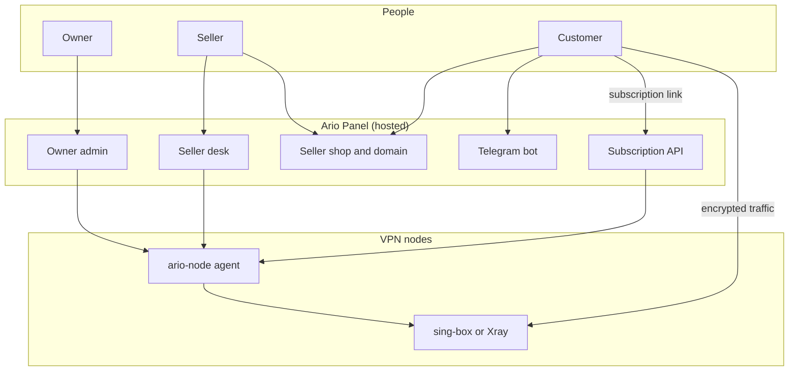

# Ario Panel

**A free, hosted VPN subscription panel. Zero logs. White-label shops for every seller. You do not run a server for the panel, and updates are handled for you.**

Website: [getario.com](https://getario.com)

Ario is for people who sell or operate VPN access. Each seller gets a shop under their own name and domain. Customers receive one subscription link that works in ordinary apps, across the protocols and cores below. This public repository introduces the panel and collects bug reports and feature requests. The main panel code remains private.

## Why Ario

- **Zero logs.** Ario does not keep a record of the sites or destinations a customer visits. The panel stores only what is needed to run the service, such as account status, traffic totals, and whether a subscription is online.
- **White-label for sellers.** Each seller has a separate storefront: display name, logo, colour, and an optional custom domain. That brand is what the customer sees on the shop, the subscription, and the Telegram bot.
- **No panel server to run.** Sellers and owners use Ario as a hosted service. You do not install or maintain the panel itself.
- **Updates are handled for you.** Panel updates are applied on the hosted service. You do not patch the panel on your own machine.
- **Completely free.** Using the panel at [getario.com](https://getario.com) is free.

VPN capacity is separate from the panel. Sellers can use a traffic pool on the owner's nodes, and, where their licence allows it, attach machines of their own. Those machines run the **ario-node** agent and a **sing-box** or **Xray** core.

## Protocols and cores

Each node runs one core, chosen when the machine is set up: **sing-box** or **Xray**. WireGuard runs on sing-box. XHTTP and VLESS encryption need Xray.

| Protocol | sing-box | Xray |
| --- | :---: | :---: |
| VLESS | Yes | Yes |
| VMess | Yes | Yes |
| Trojan | Yes | Yes |
| Shadowsocks | Yes | Yes |
| Hysteria and Hysteria2 | Yes | Yes |
| TUIC v5 | Yes | — |
| AnyTLS | Yes | — |
| SOCKS | Yes | — |
| HTTP | Yes | — |
| Naive | Yes | — |
| Mieru | Yes | — |
| WireGuard | Yes | — |

OpenVPN is also supported on a RADIUS-based NAS path, with a separate account for each user. It does not run on the sing-box or Xray cores in the table above.

### Transports for VLESS, VMess, and Trojan

| Transport | VLESS | VMess | Trojan |
| --- | :---: | :---: | :---: |
| TCP | Yes | Yes | Yes |
| WebSocket | Yes | Yes | Yes |
| gRPC | Yes | Yes | Yes |
| HTTPUpgrade | Yes | Yes | Yes |
| XHTTP | Yes, on Xray | Yes, on Xray | Yes, on Xray |

### Security

| Protocol | None | TLS | Reality |
| --- | :---: | :---: | :---: |
| VLESS | Yes | Yes | Yes, on TCP, XHTTP, or gRPC |
| VMess | Yes | Yes | — |
| Trojan | — | Yes | Yes, on TCP, XHTTP, or gRPC |

Hysteria, TUIC, and AnyTLS always use TLS. Naive requires TLS. SOCKS and HTTP can run with or without TLS.

Other options the node form supports include:

- VLESS Vision (`xtls-rprx-vision`) and VLESS encryption (on Xray)
- Encrypted Client Hello (ECH), uTLS fingerprints, certificate pinning, and ALPN
- Shadowsocks 2022 ciphers, plus obfs, v2ray-plugin, and shadow-tls
- Hysteria2 salamander obfuscation and port hopping
- TUIC congestion control (cubic, new Reno, BBR) and UDP relay modes
- Automatic certificates over HTTP or DNS, or a certificate you supply

## WireGuard and node control

WireGuard is a first-class node type on sing-box, not a side path. The panel issues per-customer peers, reports traffic for each WireGuard user, and can apply a speed limit when the agent on that machine supports it.

On every node, the **ario-node** agent:

- is installed once on the machine and then managed from the panel
- runs the core you selected, sing-box or Xray
- reports live machine status back to the panel
- applies per-user speed limits
- applies route rules from the panel
- reports per-user WireGuard traffic

## Subscriptions and clients

A customer gets one subscription link and a QR code. The panel serves the format the app asks for, including:

- Hiddify
- sing-box
- Clash and Clash Meta
- v2rayNG, v2rayN, V2Box, Streisand, Happ, and Foxray
- Shadowrocket, Quantumult X, Surge, Stash, Loon, Surfboard, and NekoBox

The shop can also offer a one-tap import into those apps. Clients only receive the nodes and features they can actually use.

## Sellers, shops, and traffic

Ario is built as a multi-seller panel. Each seller works in an isolated desk and does not see another seller's customers or shops.

- **White-label shop.** Name, logo, colour, description, and an optional domain of the seller's own.
- **Traffic pool.** The seller draws traffic from the owner's nodes, assigns it to customer plans, and can return unused traffic when a subscription is cancelled. Extra traffic packages sit on top of that pool.
- **Seller-owned nodes.** Where the licence allows it, a seller can add their own machines, still managed through the same panel and agent.
- **Plans.** Ordinary quota plans, or fair-use plans: a monthly high-speed allowance, after which the customer stays online at a lower speed on nodes that can enforce a limit.
- **More than one subscription per customer**, with usage, remaining traffic, and online status.
- **Currencies** chosen per shop, a wallet and ledger, gift cards, and extra traffic packages.

Sellers do not host the panel. They use the hosted desk and shop.

## Telegram, help, and languages

Each shop can run a Telegram bot for its customers: bind an account, view subscriptions, copy or scan a config, buy or renew, open a ticket, and set reminders.

The panel also has a knowledge base, an in-panel guide, and a ticketing desk. The interface includes English, Persian, Chinese, Russian, and Swedish.

The shop and the desks are web apps and work in a mobile or desktop browser.

## Account security

- Two-factor authentication (TOTP) with recovery codes

## How it fits together

## Screenshots

Panel screenshots will be added under [`docs/screenshots/`](docs/screenshots/) after they have been reviewed and sensitive details removed. None are included yet.

## Issues and feature requests

Open a report from [Issues](../../issues) and use one of the forms.

- For a security vulnerability, follow [SECURITY.md](SECURITY.md) and use private vulnerability reporting. Do not file it as a public issue.
- Do not include subscription links, emails, IP addresses, payment details, card numbers, or tracking numbers.

A public install script for VPN machines will be added to this repository later. Until then, the hosted panel at [getario.com](https://getario.com) is the way to use Ario.

---

# پنل آریو

**پنل اشتراک رایگان و میزبانی‌شده. بدون ثبت مقصد اتصال. فروشگاه با نام و دامنهٔ خود فروشنده. برای اجرای پنل به سرور نیاز نیست و به‌روزرسانی‌ها برای شما انجام می‌شود.**

سایت: [getario.com](https://getario.com)

این مخزن عمومی برای معرفی پنل آریو، گزارش ایرادها و پیشنهاد قابلیت‌هاست. کد اصلی پنل خصوصی می‌ماند.

## نکات اصلی

- **بدون ثبت لاگ از مقصد اتصال.** سایت‌ها و مقصدهایی که مشتری به آن‌ها وصل می‌شود ذخیره نمی‌شوند. پنل فقط آنچه برای ادارهٔ سرویس لازم است نگه می‌دارد: وضعیت حساب، مجموع مصرف، و آنلاین یا آفلاین بودن اشتراک.
- **برند فروشنده.** هر فروشنده فروشگاه جداگانه‌ای با نام، نشان، رنگ و در صورت تمایل دامنهٔ خودش دارد. همین برند روی لینک اشتراک و ربات تلگرام دیده می‌شود.
- **بدون سرور برای خود پنل.** فروشنده و مالک پنل را به‌صورت میزبانی‌شده به کار می‌گیرند و چیزی از پنل را روی سرور خود نصب نمی‌کنند.
- **به‌روزرسانی با ما.** به‌روزرسانی پنل روی سرویس میزبانی‌شده انجام می‌شود.
- **کاملاً رایگان.** استفاده از پنل در [getario.com](https://getario.com) رایگان است.

ظرفیت اتصال جدا از خود پنل است. فروشنده می‌تواند از مخزن ترافیک روی سرورهای مالک سهم بگیرد و اگر مجوزش اجازه دهد، ماشین خودش را هم اضافه کند. روی هر ماشین، عامل **ario-node** و یکی از دو هستهٔ **sing-box** یا **Xray** اجرا می‌شود.

## هسته، پروتکل و مشتری

هسته‌ها: sing-box و Xray. وایرگارد فقط روی sing-box است. XHTTP و رمزنگاری VLESS به Xray نیاز دارند.

پروتکل‌ها: VLESS (از جمله Reality و Vision)، VMess، Trojan، Shadowsocks (از جمله ۲۰۲۲)، Hysteria و Hysteria2، TUIC نسخهٔ ۵، AnyTLS، SOCKS، HTTP، Naive، Mieru و وایرگارد. OpenVPN نیز از مسیر NAS مبتنی بر RADIUS و با حساب جداگانه برای هر کاربر در دسترس است و روی هسته‌های sing-box یا Xray اجرا نمی‌شود. انتقال‌های TCP، WebSocket، gRPC، HTTPUpgrade و XHTTP برای VLESS و VMess و Trojan در دسترس است.

لینک اشتراک با برنامه‌های رایج کار می‌کند، از جمله Hiddify، sing-box، Clash و Clash Meta، v2rayNG، v2rayN، V2Box، Streisand، Shadowrocket، Quantumult X، Surge، Stash، Loon و Surfboard.

فروشنده در میز کار جداگانه کار می‌کند، طرح و حجم اضافه می‌سازد، و در صورت نیاز از طرح با مصرف منصفانه استفاده می‌کند: سهم سرعت بالا در ماه، و پس از آن ادامهٔ اتصال با سرعت کمتر. ربات تلگرام فروشگاه، صفحهٔ دانش، راهنمای داخل پنل و تیکت پشتیبانی نیز فراهم است. رابط به انگلیسی، فارسی، چینی، روسی و سوئدی در دسترس است. ورود دومرحله‌ای با کدهای بازیابی نیز برای حساب‌ها فراهم است.

## گزارش ایراد یا پیشنهاد

از بخش [Issues](../../issues) یک گزارش تازه باز کنید و یکی از فرم‌های آماده را پر کنید.

- برای ایراد امنیتی از [گزارش آسیب‌پذیری خصوصی](SECURITY.md) استفاده کنید و آن را در Issue عمومی ننویسید.
- در گزارش‌ها لینک اشتراک، ایمیل، آدرس IP، اطلاعات پرداخت، شماره کارت یا شماره پیگیری نفرستید.
